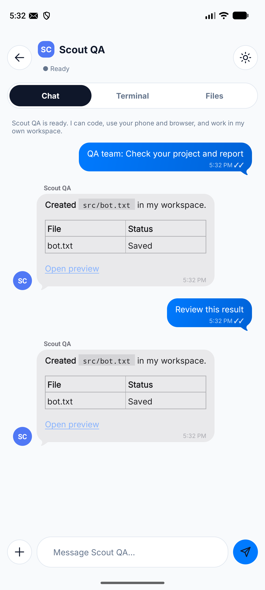
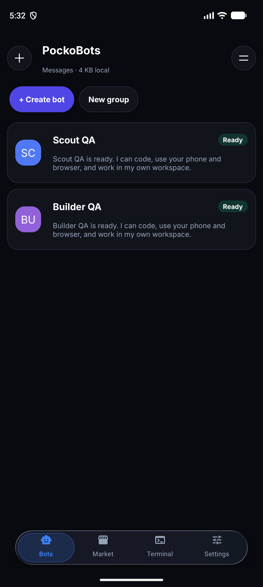
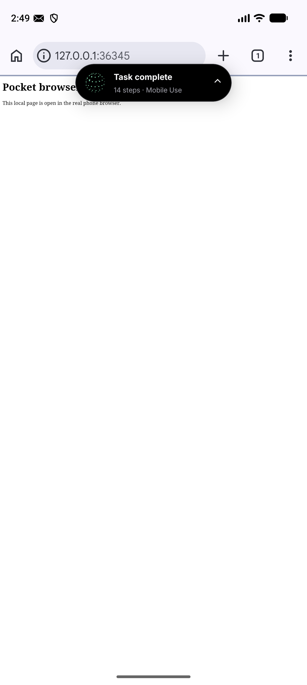

<div align="center">

# PockoBots

### Personal AI bots that live and work on your Android phone.

An open-source, phone-hosted alternative to Muse, Grok Bot and Dots.

**Free app · No platform subscription · Bring your own model · Local execution**

[Get started](#get-started) · [See the app](#see-it-in-action) · [How it compares](#how-it-compares) · [Build it](#build-from-source)

</div>

Give a bot a name, tell it what to do, and get on with your day. It can build an
app, run a project, browse the web, operate Android apps, check for updates and
message you when it needs you—all from the same conversation.

**Your phone is the computer.** Project files, terminals, Git, Node.js, npm,
Python and the task runner execute on your device. Install one packaged Android
app; its included environment sets itself up. No separate Termux installation
or rented cloud execution machine is required.

**PockoBots is free, open-source software. Model usage is separate:** bring your
own API key or sign into a supported vendor CLI and pay your chosen provider,
if applicable. The current app does
not bundle an offline language model. With a cloud provider, model requests
and relevant conversation, tool output or phone screenshots leave the device.

## What your bots can do

| Capability | In your pocket |
| --- | --- |
| Build and run software | Edit files, clone repositories, run Git, install dependencies, execute commands and start development servers. |
| Read the web | Every bot includes [Agent-Reach](docs/AGENT_REACH.md) for public web and platform readers. No separate installation; internet access and upstream service limits apply. |
| Use your phone | Operate visible Android apps and the browser through the integrated Artemis helper. The bot chooses its tools from the task. |
| Keep working in the background | Queue tasks, run proactive routines, retain notes and notify you while the app is closed. |
| Work as a team | Create customized bots with separate chats and workspaces; group chats retain each speaker, and bots can delegate bounded tasks to teammates. |
| Connect your tools | Browse 31 connection definitions, complete supported OAuth sign-ins, and attach selected remote or local MCP tools. |
| Reach you | Reply directly to notifications. Priority alerts can ring on the lock screen; Answer reveals the message and starts an installed offline Android voice. |
| Share what you build | Open clickable local previews or create a real public Dev Tunnel link after signing in. |

Each conversation has **Chat / Terminal / Files**. The bottom dock opens Bots, the MCP marketplace, a shared main terminal, and
Settings. The conversation tools menu opens bot preferences, connections,
permissions and server sharing. Markdown, code, tables and links render
right in chat.

Create a bot with just **a name and instructions**. Every bot gets the same
coding, browsing and phone capabilities. There are no mode switches or default
daily run caps.

Settings supports BYOK and phone-side CLI adapters for Codex, Claude Code,
OpenCode and Gemini. Vendor login, eligibility and usage limits remain with the
vendor. See [subscription setup and limits](docs/SUBSCRIPTIONS.md) and the
[MCP marketplace guide](docs/MCP_MARKETPLACE.md). Google Workspace needs your
OAuth client configuration; a catalog entry alone is not an authorized connection.

Hidden native-app control is experimental. A YouTube secondary-display experiment
passed on the Pixel emulator with an ADB/scrcpy companion, while Settings remained
on the main screen. The standalone app still uses the visible screen; no isolated
LinkedIn or Instagram account is claimed. See the [measured display results](docs/BACKGROUND_DISPLAYS.md).

## Built around the phone you already carry

Your phone is already with you throughout the day. PockoBots uses that hardware
for persistent personal agents, with background services, durable queues,
proactive checks and notifications. You do not need to keep a laptop open or
provision a remote machine for task execution.

Background operation is on by default. Android can still stop work after
force-stop, shutdown, battery restrictions or low memory, so **uninterrupted
24/7 operation is not guaranteed**. Phone UI actions require an unlocked screen
and the relevant Android permissions; priority alerts can appear while locked
when Android permits them.

## How it compares

PockoBots is for people who want to own the execution environment and choose
the model behind their personal bots. It is an independent project, not an
affiliated client or a promise of identical features.

| Product | Price / access snapshot | What you are choosing |
| --- | --- | --- |
| **PockoBots** | **$0 platform subscription.** BYOK model charges are separate. | Open-source Android app; files, shell tools and app actions execute on your own phone. No PockoBots account or country rollout gate. Your provider and connected services have their own availability rules. |
| **Grok Bot** | Premium is listed at **$30/month**; other eligible plans may include access. | Grok Bot's computer, scheduled routines and included bot usage. [Official product and pricing](https://x.ai/bot). |
| **Dots** | Individual access includes eligible Pro tiers, starting at **$100/month**. | ChatGPT's personal agent, subject to plan eligibility and rollout. [Official access guide](https://learn.chatgpt.com/docs/dots) · [Official Pro pricing](https://learn.chatgpt.com/docs/pricing). |
| **Muse** | Free for many uses, with optional paid plans; regional rollout. | Meta's personal agent and cloud VM. Availability has expanded beyond North America, including [Japan](https://about.fb.com/ja/news/2026/10/muse-personal-ai-agent-launches-in-japan/) and [Singapore](https://about.fb.com/news/2026/10/muse-is-now-available-in-singapore-the-worlds-first-personal-ai-agent-built-for-everyone/). |

Comparison checked **October 28, 2026**. Listed dollar prices are USD; vendor
plans, included usage and availability can change. PockoBots has no software
subscription, but inference, internet access and external services can cost money.

## See it in action

Actual Android emulator captures using local test fixtures:

<table>
<tr>
<td align="center"><br>One conversation</td>
<td align="center"><br>Your local bots</td>
<td align="center"><br>Real phone control</td>
</tr>
</table>

[More screenshots: sidebar, terminals, settings and setup](docs/UI.md).

## Try a task

- "Build me a to-do app in HTML, CSS and JavaScript. Run it and give me a preview link."
- "Clone this repository, investigate the failing tests, and show me the fix."
- "Open the phone browser, research these options, and summarize what you find."
- "Check this project every morning and notify me when something needs attention."

Bots report tool results, ask for missing information and keep their work in
separate project directories. Phone actions share one device and take turns.
Repeated app/page reopening pauses instead of looping indefinitely.

## Get started

> [!WARNING]
> **This is v0.1 beta — it may have issues.**
> PockoBots runs complex local agent runtimes, package managers, and background services directly on your Android device. Android battery management, vendor-specific background killers, and device sleep may cause unexpected interruptions. Please report any issues or edge cases on GitHub!

### How to install on your phone

1. **Download the APK:**
   Download the latest **[PockoBots v0.1 Beta APK](https://github.com/AliSharjeell/PockoBots/releases/tag/v0.1)** (`pockobots-v0.1-debug.apk`) directly to your phone from the [GitHub Releases](https://github.com/AliSharjeell/PockoBots/releases/tag/v0.1) page.
2. **Allow installation from your browser or file manager:**
   Tap the downloaded `.apk` file. If Android displays a security prompt saying your phone isn't allowed to install unknown apps from this source, tap **Settings** and enable **Allow from this source**, then tap **Install**.
3. **First launch & runtime unpack:**
   Open PockoBots. On first launch, the app automatically unpacks the packaged Node.js, Python, Git, and task environment to private app storage. Ensure you have approximately 1–2 GB of free device storage and allow 1–2 minutes for the initial unpack to complete.
4. **Follow Setup & permissions:**
   From the initial setup screen, enable the permissions you plan to use:
   - **Notifications:** Receive bot updates and completion alerts.
   - **Display over other apps:** Allows the floating bot pill overlay to float above Chrome and other apps.
   - **Priority ringing alerts:** Allows emergency calls and urgent reminders to ring the phone.
   - **Accessibility service (Artemis):** Opt-in permission needed only if you want bots to interact with visible Android apps or the browser.
5. **Connect your model (BYOK):**
   Open **Settings > Bring your own key**. Select an OpenAI-compatible or Anthropic-compatible provider, enter your model name, base URL, and API key, and tap Save.
6. **Create a bot and start working:**
   Give your bot a name and instructions. Every bot can code, run servers, open previews in Chrome, schedule calls, and listen for external webhooks.

Existing builds and historical artifacts can also be inspected under [GitHub Releases](https://github.com/AliSharjeell/PockoBots/releases).

Shell commands without per-command prompts and ringing access are enabled by
default. Per-bot preferences let you change these settings. Provider keys live
in private app storage without additional file encryption; shell tools have
access to the app's runtime account. See [bot setup and behavior](docs/BOTS.md)
and [phone-control permissions and privacy](docs/MOBILE_USE.md).

### Open a preview on another phone

A `127.0.0.1` preview opens on the device hosting the project. To reach an emulator
or phone server from another device, open **Servers & sharing**, sign in to
Microsoft Dev Tunnels and share the server's port. Use the actual public URL
shown in the logs. Public sharing needs internet access and the tunnel provider's
account; the agent control port cannot be shared through this API.

## What is local?

| Runs or stays on your phone | Uses your chosen connection |
| --- | --- |
| Agent orchestration, queues and routine scheduling | Model inference through your configured BYOK endpoint |
| Project files, chat storage and bot notes | Remote MCP tools, connected websites and external APIs |
| Bash, Git, Node.js, npm, Python and development servers | Git hosting, package downloads and optional public tunnels |
| Artemis actions and the native floating island | Screen images/text sent to the model for phone tasks |
| Installed offline Android TTS voices | Any service you explicitly connect |

**Local execution does not mean offline inference.** No PockoBots-hosted backend
is needed for execution, but the current app requires a working model endpoint
for AI tasks. Installing the app alone does not provide a free offline model.

## Build from source

```bash
gh repo clone AliSharjeell/PockoBots
cd PockoBots
npm ci
npm run check
npm run build:android
```

Use Node.js **22.19+**, JDK **17**, Android SDK **36** and NDK **27.2.12479018**.
The Gradle wrapper selects Gradle 8.13. A fresh checkout also needs the packaged
Linux runtime; generate it on Linux/WSL with Docker, Python 3, curl, dpkg-deb and
patchelf:

```bash
python3 runtime/package.py arm64   # use amd64 for an x86_64 emulator
cd android
./gradlew :app:assembleDebug :app:lintDebug -PruntimeAbi=arm64-v8a
```

The APK is written to `android/app/build/outputs/apk/debug/app-debug.apk`.
For x86_64, package `amd64` and build with `-PruntimeAbi=x86_64`. Copy the APK
before building another ABI; both use the same output path.

For day-to-day development, open **the `android` directory** in Android Studio,
select a running emulator and click Run. [Development guide](docs/DEVELOPMENT.md)
covers source edits, logs, isolated QA builds and the experimental 16 KB Intel
emulator workaround. Physical ARM64 and ARM64 16 KB support have not been
established by the current emulator testing.

Backend checks run on Linux/WSL:

```bash
npm run check
npm test
npm run build
```

The native Android UI does not use a WebView. The standalone Node backend and
browser UI remain available for development.

## Project status

PockoBots is preview software. Version 0.5's verification includes **20 backend
checks** and **four Android test journeys** on a Pixel 10 Pro XL API 37 emulator
in 4 KB mode. Coverage includes mixed coding/phone tasks, real terminals, Git,
npm servers, MCP, Markdown, notification replies, ringing alerts and restart
behavior. Real paid providers and authenticated public tunnel creation were not
part of the local-fixture checks.

Read [verification details](docs/VERIFICATION.md), [bot behavior](docs/BOTS.md),
[development setup](docs/DEVELOPMENT.md) and the [OpenBot research notes](docs/OPENBOT_RESEARCH.md).

## License and credits

PockoBots application source is [MIT licensed](LICENSE). Included components keep
their own licenses: the terminal implementation, Artemis helper, PRoot, Debian
packages, native libraries and JavaScript/Markdown dependencies. See
[runtime notices](runtime/NOTICE.md), [Artemis provenance](third_party/artemis/UPSTREAM.md)
and bundled license notices. OpenBot informed the product research; its source
was not copied into this MIT project.
