# Native sidebar and island UI

## Unified bot workspace in v0.5

Actual Pixel captures from the isolated QA installation, using local fixtures.
Each bot handles coding and phone/browser work in the same conversation.

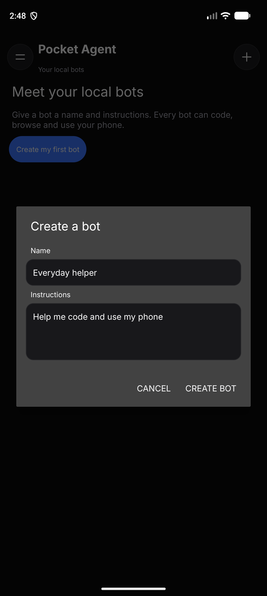

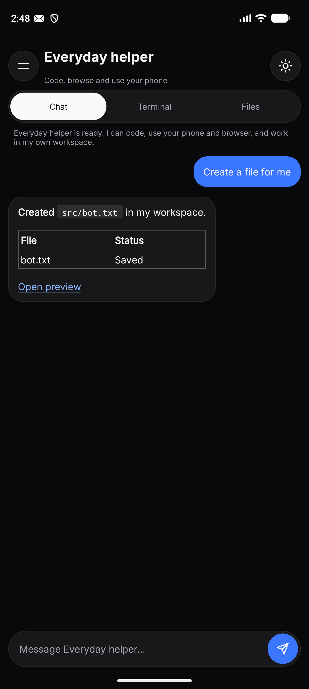

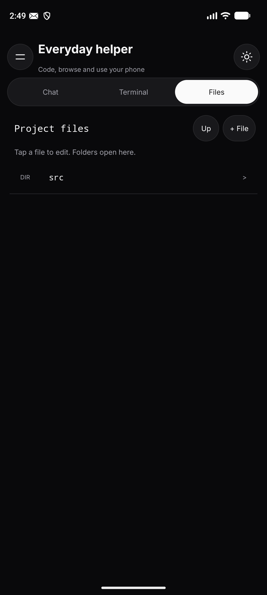

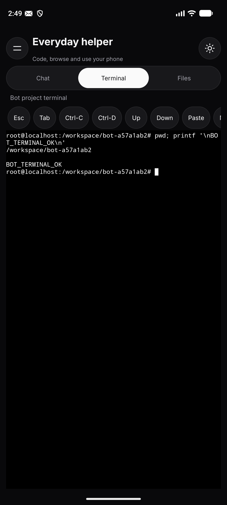

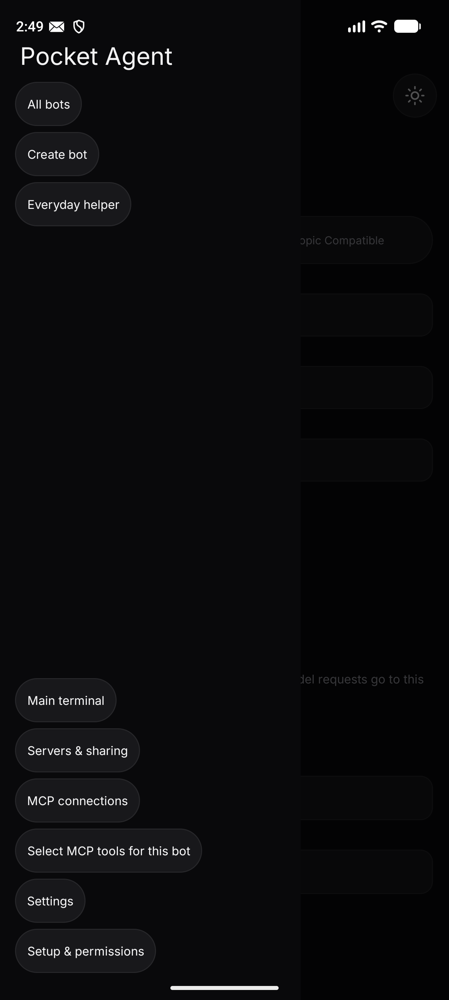

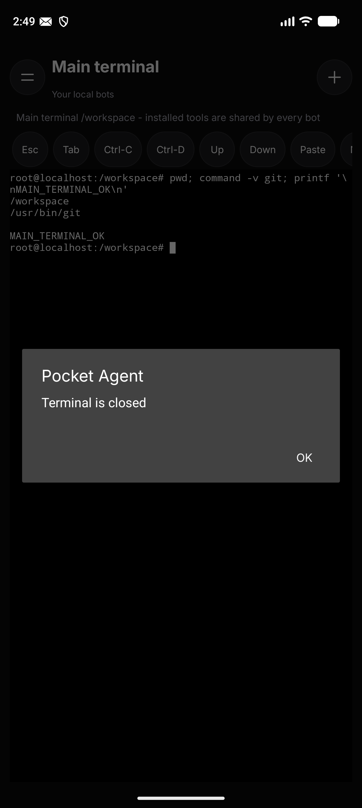

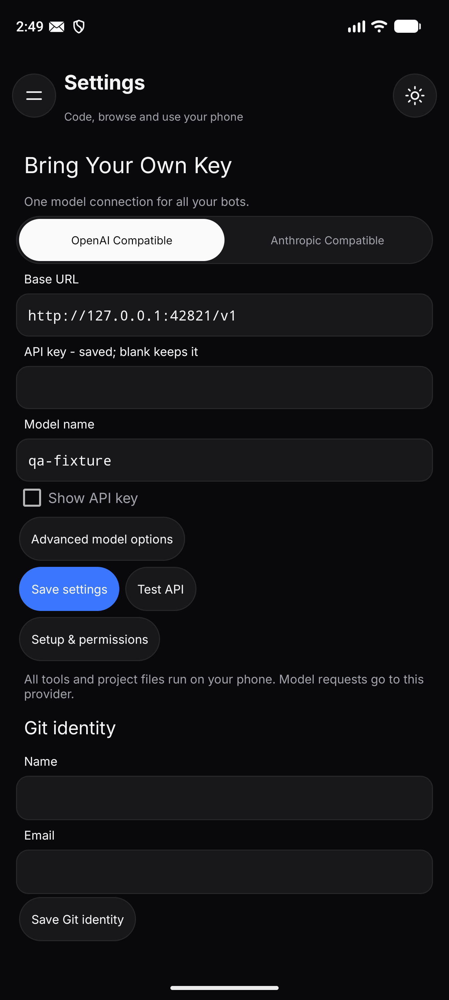

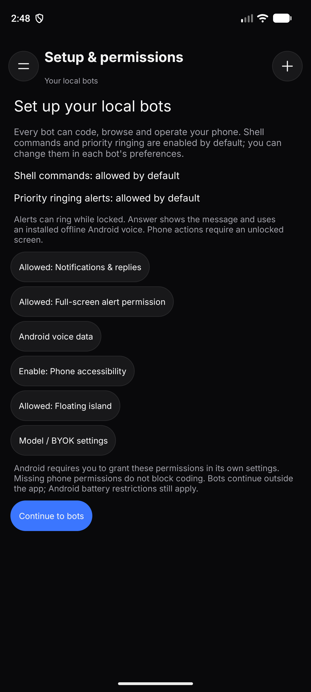

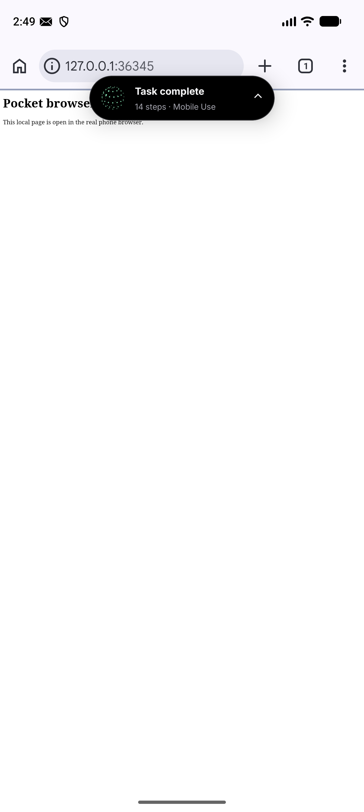

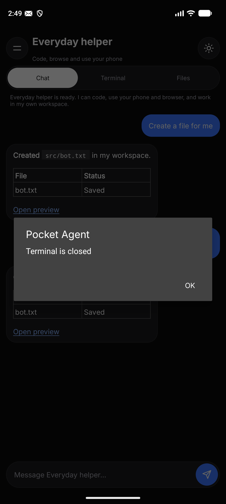

## Bot inbox and priority alerts in v0.4

The new launcher is a messaging inbox with separate coding, phone and browser
bots. These captures come from the Pixel 10 Pro XL API 37 emulator, using local
model fixtures and the real packaged runtime and Artemis helper.

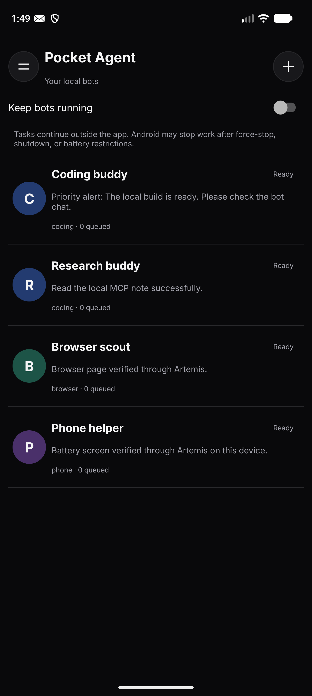

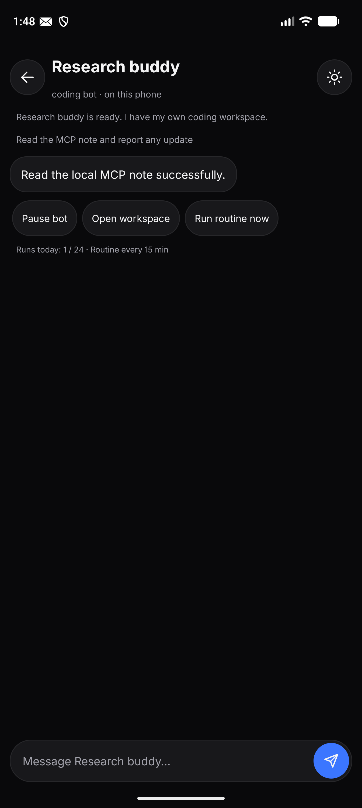

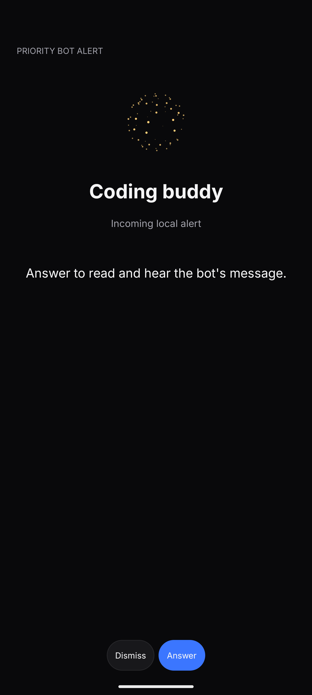

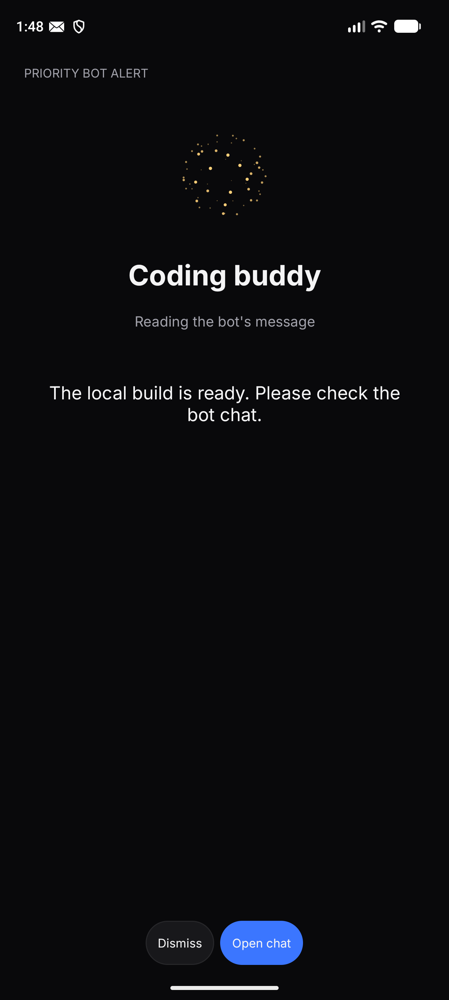

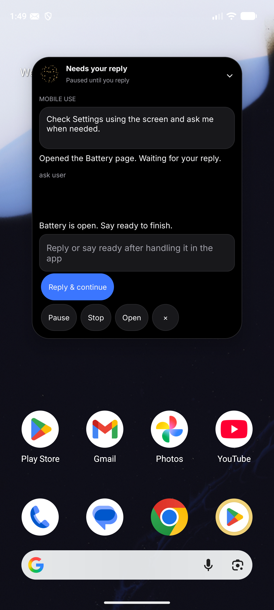

## Original sidebar adaptation

Pocket Agent v0.3.1 adapts the supplied `form-filling-ai` sidebar and screenshot
references to native Android views. Inter, zinc surfaces, white active segments,
blue user bubbles and actions, a history drawer, collapsible tool output, and
the bottom composer follow the extension's layout. Workspace tools remain
available from the drawer.

The floating controller is a black rounded island near the top center of the
phone. Its width and height animate when expanded or collapsed. A dotted orb
rotates and solves while the task runs, with white caption shimmer, amber while
waiting, and green on completion. Tap or drag the header; the expanded panel
keeps output, questions, replies, and task controls accessible.

The orb is a Canvas adaptation of the MIT-licensed `thinking-orbs` 0.3.2
`solving`/`rubik` engine used in the extension's ChatView. The attribution is
packaged at `assets/licenses/thinking-orbs-MIT.txt`. Orb and shimmer animation
respect Android's animation setting and stop drawing frames when hidden.

## Emulator captures

These are actual Android 14 screenshots using local model fixtures, without
real provider credentials. System Settings hides application overlays, so the
island and reply panel are captured on Home.

| Screen | Screenshot |
| --- | --- |
| Coding chat | [Chat](images/v0.3.1-ui-chat.png) |
| History drawer | [Drawer](images/v0.3.1-ui-drawer.png) |
| Model settings | [BYOK](images/v0.3.1-ui-settings.png) |
| Mobile Use composer | [Mobile Use](images/v0.3.1-ui-mobile.png) |
| Collapsed island | [Island](images/v0.3.1-mobile-island.png) |
| Expanded question | [Reply panel](images/v0.3.1-mobile-waiting.png) |

## Edit the native implementation

`AgentStyle.java` contains tokens and control surfaces; `MainActivity.java`
builds screens and navigation. `AgentIcon.java` draws outline icons.
`ThinkingOrbView.java` and `ShimmerTextView.java` draw the animations.
`MobileOverlayService.java` owns the floating window and expansion animation.
These files are in `android/app/src/main/java/dev/pocket/agent`.

Reference layouts were read from `src/components/ChatView.tsx`,
`src/components/SettingsView.tsx`, `src/sidepanel/App.tsx`, and
`src/styles/globals.css` in `C:\AppsNew\form-filling-ai`.
